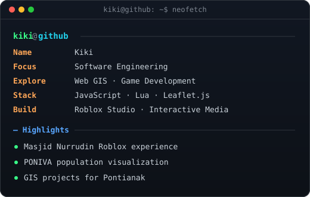

<table>
<tr>
<td valign="top" align="center"></td>
<td valign="top" align="center"></td>
</tr>
</table>

  <table border="1" bordercolor="#30363d" cellpadding="6" cellspacing="0" width="370">
    <tr><td align="center">🔴 🟡 🟢 &nbsp; kiki@discord: ~$ activity.sh</td></tr>
    <tr><td align="center"></td></tr>
    <tr><td><code>kiki@discord:~$ status --live</code></td></tr>
  </table>

