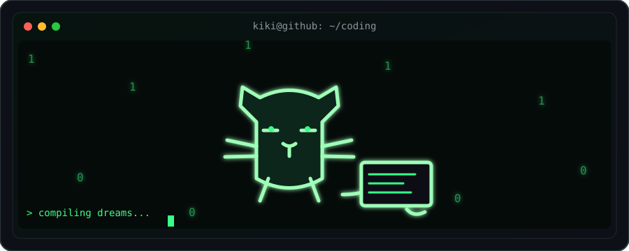

<div align="center">
  
</div>

<table width="100%">
<tr>
<td width="48%" valign="top" align="center">

### `kiki@github:~$ ./coding`


</td>
<td width="52%" valign="top">

```text
kiki@github:~$ whoami
Kiki — Informatics Engineer

kiki@github:~$ focus
Software Engineering • Web GIS • Game Development

kiki@github:~$ stack
JavaScript • Lua • Roblox Studio • Leaflet.js

kiki@github:~$ highlights
→ Masjid Nurrudin Islamic experience on Roblox
→ PONIVA population visualization platform
→ GIS and digital projects for Pontianak
```

<div align="center">
  <a href="https://discord.com/users/867236993683816458">
    
  </a>
</div>

</td>
</tr>
</table>

<div align="center">

```text
> connection established
> welcome to Kiki's corner of the Matrix
```

</div>
