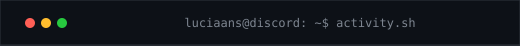
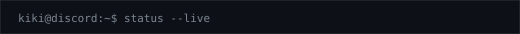

<table>
<tr>
<td valign="top" align="center">🔴 🟡 🟢 &nbsp; luciaans@github: ~$ ./coding.sh  <code>luciaans@github:~$ compiling snacks...</code></td>
<td valign="top" align="center">🔴 🟡 🟢 &nbsp; luciaans@github: ~$ ./focus.sh  <code>luciaans@github:~$ judging your code...</code></td>
</tr>
</table>

   
   
  

