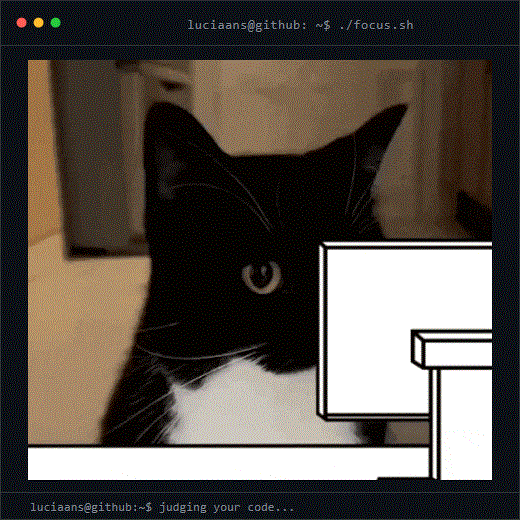
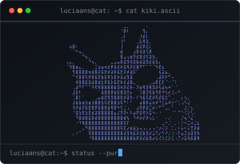

<table>
<tr>
<td valign="top" align="center"></td>
<td valign="top" align="center"></td>
</tr>
<tr>
<td valign="top" align="center" width="370">
  
  
  
</td>
<td valign="top" align="center" width="370">
  
</td>
</tr>
</table>

